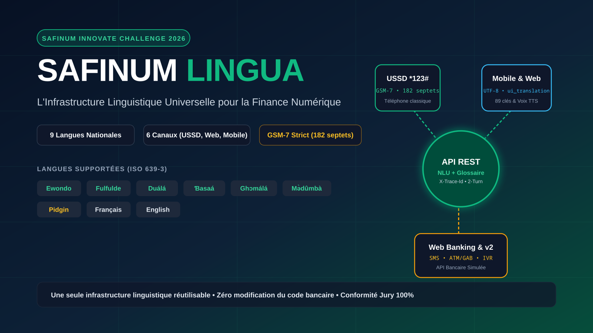

# Dossier Complet des Livrables — Équipe Dev space ICT

Ce dossier regroupe l'ensemble des **livrables attendus (Section 11)** du **SAFINUM Innovate Challenge 2026 — Challenge Final** pour le projet **Safinum Lingua** (*Infrastructure Linguistique Universelle*).

## Correspondance exacte avec la Section 11 de l'énoncé

| # | Livrable attendu (§11) | Dossier & Fichiers fournis |
|---|---|---|
| 1 | **Un prototype fonctionnel** | `01_Prototype_Fonctionnel/01_PROTOTYPE_FONCTIONNEL.pdf` (.md) + Middleware (`safinum-middleware/`, port 3000) + Service IA (`traduction_service_google/`, port 3001) + Mot-à-Mot (`traduction_mot_a_mot/`, port 3002) + Extension Chrome `Safinum_Lingua_Extension_v0.3.0.zip` |
| 2 | **Démonstration d'interopérabilité (≥ 3 canaux)** | `02_Demonstration_Interoperabilite_Multicanal/02_INTEROPERABILITE_MULTICANAL.pdf` (.md) + `safinum_multicanal.png` |
| 3 | **Documentation de l'architecture technique** | `03_Documentation_Architecture_Technique/03_ARCHITECTURE_TECHNIQUE.pdf` (.md) + `safinum_architecture.png` |
| 4 | **Description de la technologie linguistique** | `04_Description_Technologie_Linguistique/04_TECHNOLOGIE_LINGUISTIQUE.pdf` (.md) + `safinum_ai_phonetics_pipeline.png` + lexique CSV + références phonologiques |
| 5 | **Démonstration d'opération financière complète** | `05_Demonstration_Operation_Financiere/05_DEMONSTRATION_OPERATIONS.pdf` (.md) + `traces_10_scenarios_jury.json` |
| 6 | **Explication du mécanisme d'intégration** | `06_Explication_Mecanisme_Integration/06_MECANISME_INTEGRATION.pdf` (.md) + `safinum_integration_contracts.png` + `register_endpoints.ps1` |
| 7 | **Documentation technique & Spécifications API** | `07_Documentation_Technique_Specifications_API/07_SPECIFICATIONS_API.pdf` (.md) + `openapi_middleware.json` + `openapi_service_google.json` + `openapi_mot_a_mot.json` |
| 8 | **Potentiel de scalabilité et déploiement** | `08_Scalabilite_Deploiement_et_Presentation/08_SCALABILITE_DEPLOIEMENT.pdf` (.md) + `Safinum_Lingua_Presentation_Dev_Space_ICT.pptx` |
| 9 | **Visuels, schémas et captures** | `09_Visuels_et_Captures/` (PNG, SVG, captures des simulateurs et des interfaces locales) |
