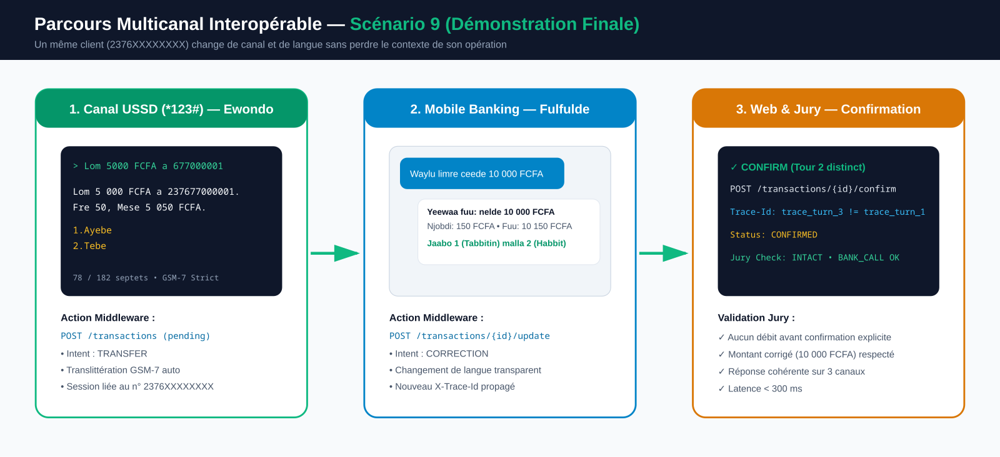
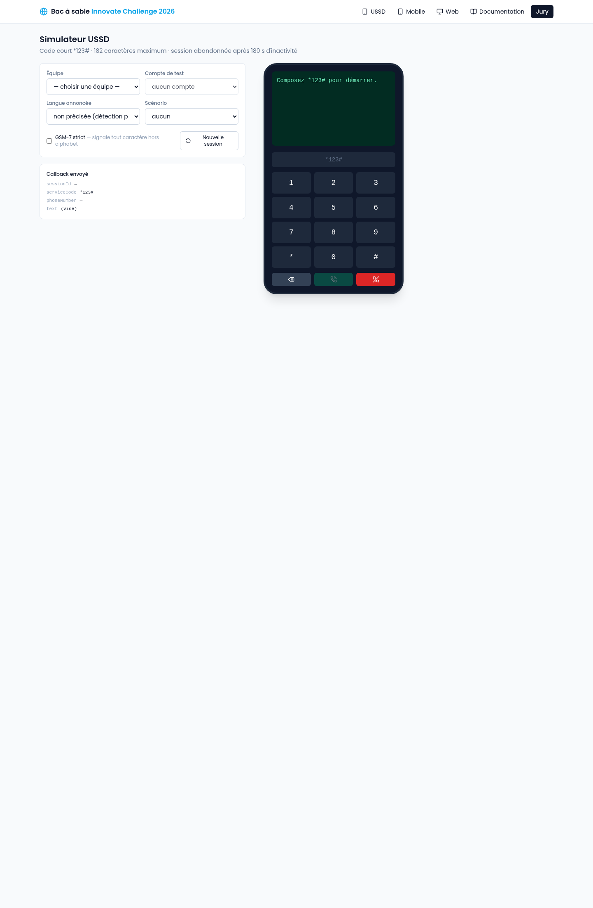
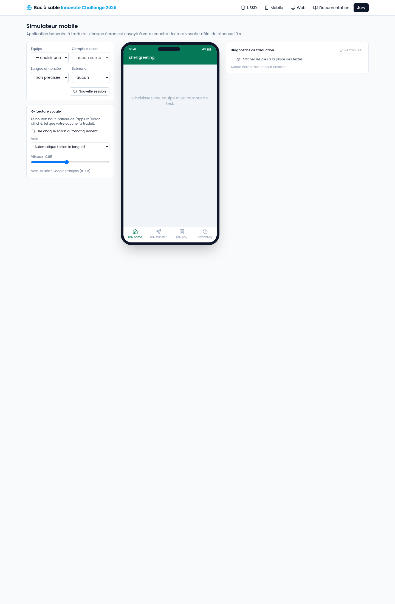
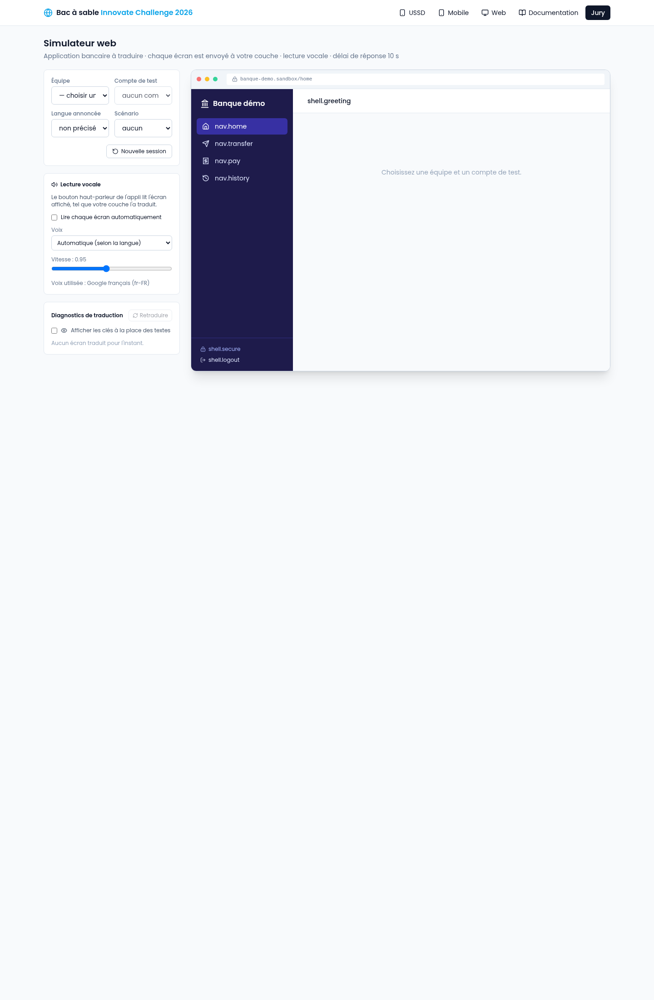
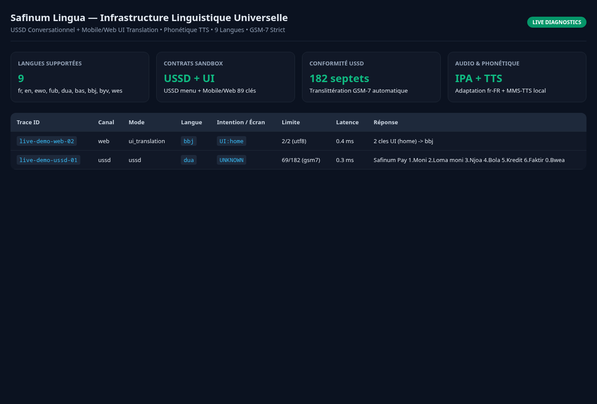
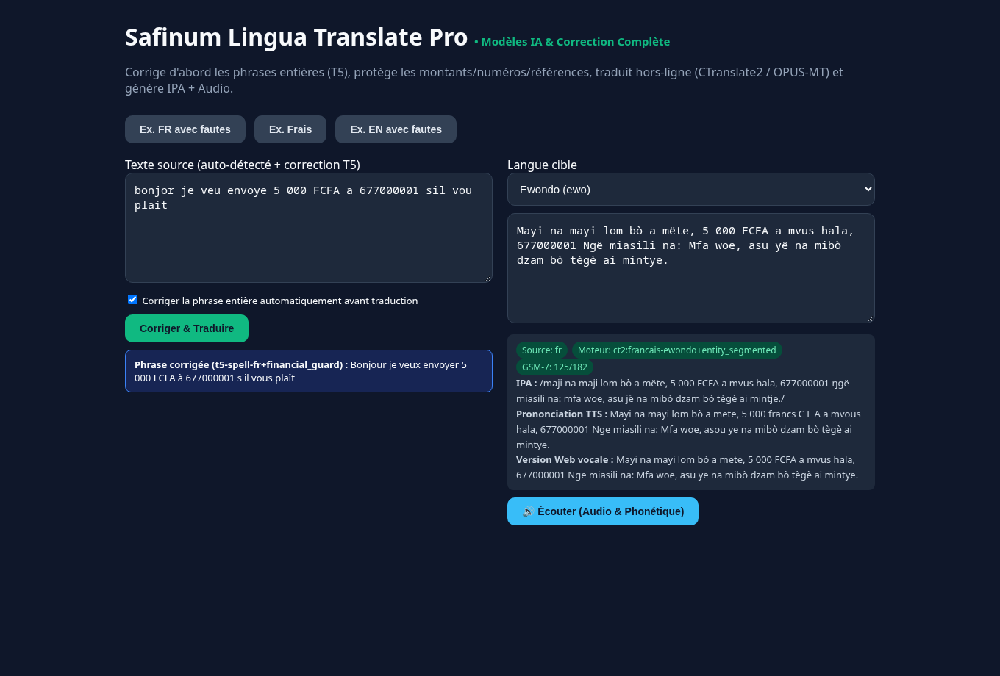
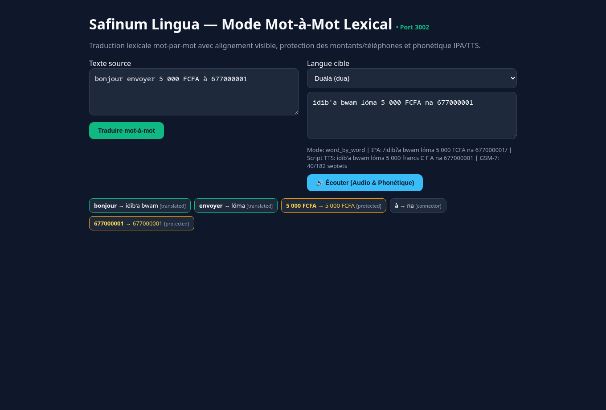

# 2. Démonstration de l'Interopérabilité Multicanale (6 Canaux)

## Couverture des canaux exigés et étendus

| Canal | Statut Sandbox | Contrat implémenté | Contraintes respectées |
|---|---|---|---|
| **USSD (`*123#`)** | Actif (obligatoire) | Conversationnel `POST /middleware` | Alphabet GSM-7 strict, <= 182 septets, `options: list[str]`, délai < 3 s, confirmation en 2 tours (`X-Trace-Id` distinct). |
| **Mobile Banking** | Actif (obligatoire) | `type: "ui_translation"` | UTF-8, 89 clés officielles sur 6 écrans, `{placeholders}` intacts, `max_chars` respecté, phonétique TTS `fr-FR` pour Lecture Vocale. |
| **Web Banking** | Actif (obligatoire) | `type: "ui_translation"` + Extension Chrome | Même couche réutilisable + extension navigateur pour sites bancaires tiers sans modification de code source. |
| **SMS (v2)** | Prêt dans le moteur | `fit_channel_constraints(channel="sms")` | Calcul exact des segments GSM-7 (`160` / `153` septets) et UCS-2 (`70` / `67`). |
| **ATM / GAB (v2)** | Prêt dans le moteur | Entrée clavier numérique | Validation des montants multiples de `5 000 FCFA`, gabarits sans texte libre. |
| **IVR Vocal (v2)** | Prêt dans le moteur | Audio WAV `16 kHz / 8 kHz` + MMS-TTS | Transcription IPA, script TTS `fr-FR`/`en` et synthèse WAV locale (`MMS-TTS`). |

## Scénario d'interopérabilité cross-canal (Scénario 9)
1. Un client initie un transfert de `5 000 FCFA` sur **USSD (`*123#`)** en **Ewondo** (`POST /transactions` -> statut `pending`).
2. Sur **Mobile Banking** (puis **Web Banking**), avec le même numéro normalisé `2376XXXXXXXX`, la transaction en attente reste visible dans l'historique traduit en **Fulfulde / Duálá / Ghɔmálá'**, peut être modifiée (`POST /transactions/{id}/update`) ou confirmée (`POST /transactions/{id}/confirm`) sans jamais provoquer de double exécution.

## Simulateurs Officiels & Interfaces Déployées

| Simulateur USSD (`*123#`) | Simulateur Mobile Banking | Simulateur Web Banking |
|---|---|---|
|  |  |  |

| Dashboard Middleware (Port 3000) | Traducteur IA & Correction T5 (Port 3001) | Mode Mot-à-Mot Lexical (Port 3002) |
|---|---|---|
|  |  |  |
