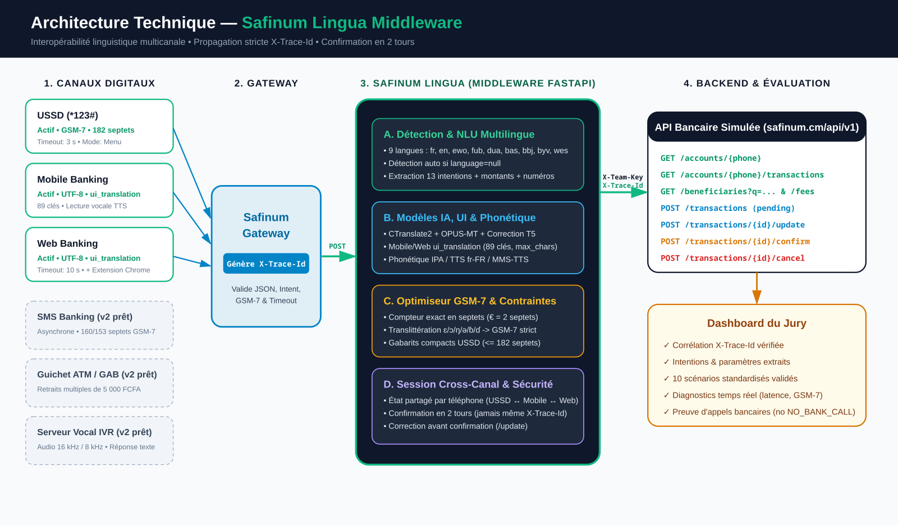

# 3. Documentation de l'Architecture Technique Proposée

## Architecture modulaire en 4 couches

1. **Couche Canaux & Passerelle (`Safinum Gateway`)** :
   - Achemine vers un endpoint unique `POST /middleware` les requêtes hétérogènes : tours USSD (`input`) et écrans Mobile/Web (`type == "ui_translation"`).
   - Fournit un `X-Trace-Id` unique par tour utilisateur et les contraintes du canal (`charset`, `max_chars`, `timeout_ms`).
2. **Couche Intelligence Linguistique (`safinum-middleware/app/`)** :
   - `main.py` : routeur FastAPI asynchrone aiguillant USSD conversationnel et `ui_translation`, plus endpoints `/api/translate`, `/api/phonetics`, `/api/grammar`, `/api/audio/tts` et Dashboard live `/`.
   - `nlu.py` : NLU hybride combinant extraction déterministe ultra-rapide (< 5 ms) pour les 13 intentions standard + repli neuronal local CTranslate2 (`cameroon-int8` `<lang>-francais`) sur phrases libres inédites.
   - `ui_translator.py` : moteur `ui_translation` couvrant les 89 clés officielles × 9 langues avec contrôle automatique des `{placeholders}`, `max_chars`, mise en cache par clé, et traduction IA dynamique de secours.
   - `phonetics.py` : conversion AGLC ↔ IPA ↔ Script TTS `fr-FR`/`en`, adaptation phonétique Web/Mobile pour le lecteur vocal du sandbox, et synthèse WAV locale via Meta MMS-TTS.
   - `gsm7.py` : table GSM 03.38 complète (base + étendue `€^{}\[~]|`), translittération `ɛ/ɔ/ŋ/ə/ɓ/ɗ`, troncature propre <= 182 septets.
   - `session_store.py` : état session cross-canal indexé par téléphone normalisé `2376XXXXXXXX` avec garde-fou anti-auto-confirmation sur un même `X-Trace-Id`.
3. **Couche Modèles IA Locaux (`models/`, `traduction_service_google/`, `traduction_mot_a_mot/`)** :
   - Correction grammaticale/orthographique de phrases entières (`T5` FR & EN) et traduction neuronale hors-ligne (`CTranslate2` + `OPUS-MT-Bantu/Mul`).
4. **Couche Backend Bancaire (`bank_client.py`)** :
   - Client `httpx` asynchrone (`timeout <= 2.0 s` pour respecter la limite USSD de `3 s`) propageant `X-Team-Key` et `X-Trace-Id` sur chaque requête vers `https://www.safinum.cm/api/v1`.
