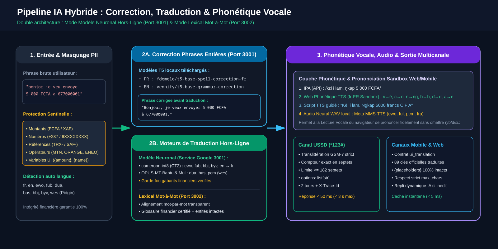

# 4. Description de la Technologie Linguistique & Phonétique

## Langues prises en charge (9 langues)
- **8 langues officielles du sandbox (ISO 639-3)** : **Duálá (`dua`)**, **Ewondo (`ewo`)**, **Ɓasaá (`bas`)**, **Ghɔmálá (`bbj`)**, **Mə̀dûmbà (`byv`)**, **Fulfulde (`fub`)**, **Français (`fr`)**, **English (`en`)**.
- **+ Pidgin camerounais (`wes` / Kamtok)** hérité de la phase de présélection, avec **détection automatique** lorsque `language=null`.

## Modèles IA locaux téléchargés hors-ligne (`models/`)

| Modèle / Ressource | Architecture | Rôle dans le système | Langues couvertes |
|---|---|---|---|
| `flagship-ai/cameroon-int8` | MarianMT quantifié **CTranslate2 int8** (`repetition_penalty=1.35`) | Traduction neuronale rapide (~100 ms CPU) bidirectionnelle pivot français + repli NLU | `fr` ↔ `ewo`, `fub`, `bbj`, `byv`, `en` |
| `Helsinki-NLP/opus-mt-tc-bible-big-...-bnt` | MarianMT (`>>bas<<`) + sens retour `-bnt-...` | Traduction neuronale Ɓasaá avec garde anti-hallucination Bantu | `fr`/`en` ↔ `bas` |
| `Helsinki-NLP/opus-mt-tc-bible-big-...-mul` | MarianMT (`>>pcm<<`) | Traduction neuronale vers Cameroonian Pidgin (`wes`) | `fr`/`en` → `wes` (`pcm`) |
| `yemen2016/ewondo-french-model` | MarianMT (`ewondo -> français`) | Modèle Ewondo-Français téléchargé et évalué localement | `ewo` → `fr` |
| `fdemelo/t5-base-spell-correction-fr` | **T5 Seq2Seq** (`grammaire: `) | Inspection et correction orthographique/grammaticale de **phrases entières** françaises | `fr` |
| `vennify/t5-base-grammar-correction` | **T5 Seq2Seq** (`grammar: `) | Inspection et correction grammaticale de **phrases entières** anglaises | `en` |
| `Meta MMS-TTS` + `exyms/ewondo-tts-speecht5` | **VITS Neural TTS** & **SpeechT5** | Synthèse vocale audio WAV 16 kHz hors-ligne | `ewo`, `fub`, `wes`, `fr` |

## Datasets & Corpus Linguistiques Locaux (`datasets/` & `app/data/`)
- **`OlameMend/soreva`** : 150 phrases parallèles alignées en 7+ langues camerounaises (`ewo_cm`, `bbj_cm`, `bas_cm`, `dua_cm`, `fub_cm`, `pcm_cm`, `byv_cm`) avec graphies tonales AGLC et formes normalisées ASCII.
- **`FredMike23/french-FULFULDE-ADAMAOUA`** (42 768 entrées) & **`BATBAINA/fulfulde-dataset-asr-agri`** : lexique bilingue Français ↔ Fulfulde Adamaoua filtré pour la finance et la vie courante.
- **`michsethowusu/english-cameroon-pidgin_sentence-pairs_mt560`** (28 159 paires) : phrases parallèles Anglais ↔ Cameroonian Pidgin.
- **`safinum-middleware/app/data/cameroon_corpus_extract.json`** : index léger compilé (194 Ko) utilisé en local par la traduction et le mode mot-à-mot.

## Traitement Phonétique & Prononciation Vocale (Sandbox Web/Mobile & TTS)
Le simulateur Web/Mobile du bac à sable utilise la synthèse vocale du navigateur (`Google français fr-FR`) pour lire directement les textes retournés à l'écran :
- Les glyphes AGLC purs (`ɛ`, `ɔ`, `ŋ`, `ə`, `ɓ`, `ɗ`, `ɑ`, `ʼ`) et les tons combinants rares sont ignorés ou déformés par les voix `fr-FR` standard.
- Notre module `phonetics.py` intervient à trois niveaux :
  1. **Adaptation Web/Mobile (`to_web_phonetic_safe`)** : convertit `ɛ→è`, `ɔ→o`, `ɑ→a`, `ŋ→ng/nk`, `ɓ→b`, `ɗ→d`, `ə→e`, `ʉ→ou` tout en conservant les emplacements `{amount}`, `{name}` et les limites `max_chars`.
  2. **Script vocal guidé (`to_tts_script`)** : adapte la phonétique (`u→ou`, `ny→gn`, `ch→tch`, `FCFA→francs C F A`) sans casser les digrammes `eu`/`ou`/`au`.
  3. **Transcription IPA (`to_ipa`) & Audio WAV (`synthesize_wav_bytes`)** : fournit l'alphabet phonétique international et la lecture neurale MMS-TTS.

## Sécurité financière & Validation linguistique
- **Protection sentinelle** : montants (`FCFA`/`XAF`), téléphones (`+237`/`6XXXXXXXX`), références (`TRX-`/`SAF-`) et facturiers sont masqués par sentinelles numériques avant tout appel IA puis restaurés avec vérification stricte d'unicité.
- **Sources & Précautions** : lexique validé `liste_mots_a_traduire.csv` (142 entrées), dictionnaires camerounais reconnus (AGLC, Glosbe, Resulam, Kemelang, CNRS, Abbé Tsala), enregistrements natifs Wikimedia/Lingua Libre (`CC BY-SA 4.0` / `CC0`), et respect des précautions tonologiques sur le Ghɔmálá' (Rolle 2025).
