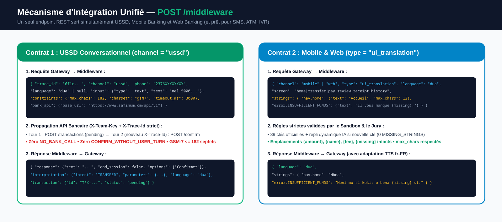

# 6. Explication du Mécanisme d'Intégration



## Principe : Zéro modification du cœur bancaire
Les banques, fintechs et opérateurs télécoms n'ont rien à réécrire dans leurs systèmes existants :
- La passerelle applicative (`Safinum Gateway`) envoie un `POST` JSON vers une **URL publique unique** (`https://<tunnel>/middleware`) déclarée pour les 3 canaux (`ussd`, `mobile`, `web`).
- Notre middleware inspecte la requête et aiguille automatiquement :
  - Si `type == "ui_translation"` (`mobile` / `web`) : traduit toutes les clés de l'écran et renvoie `{"language": "...", "strings": {...}}` sans appeler l'API bancaire (l'application cliente exécute la transaction).
  - Sinon (`ussd`) : analyse l'intention, appelle l'API bancaire (`https://www.safinum.cm/api/v1`) en recopiant strictement les en-têtes `X-Team-Key` et `X-Trace-Id`, formate la réponse en GSM-7 <= 182 septets et gère la confirmation au tour suivant.

## Procédure d'enregistrement auprès du Sandbox SAFINUM

1. Exposer le middleware local (port `3000`) via tunnel HTTPS :
   ```bash
   ngrok http 3000
   # ou
   cloudflared tunnel --url http://localhost:3000
   ```
2. Déclarer les 3 canaux (`ussd`, `mobile`, `web`) avec votre clé d'équipe :
   ```bash
   for ch in ussd mobile web; do
     curl -s -X POST "https://www.safinum.cm/api/v1/sandbox/endpoint" \
       -H "X-Team-Key: sbx_VOTRE_CLE" \
       -H "Content-Type: application/json" \
       -d "{\"channel\":\"$ch\",\"url\":\"https://VOTRE-URL/middleware\"}"
   done
   ```
   (Sous Windows PowerShell : `.\register_endpoints.ps1 -TeamKey "sbx_VOTRE_CLE" -PublicUrl "https://VOTRE-URL"`.)
