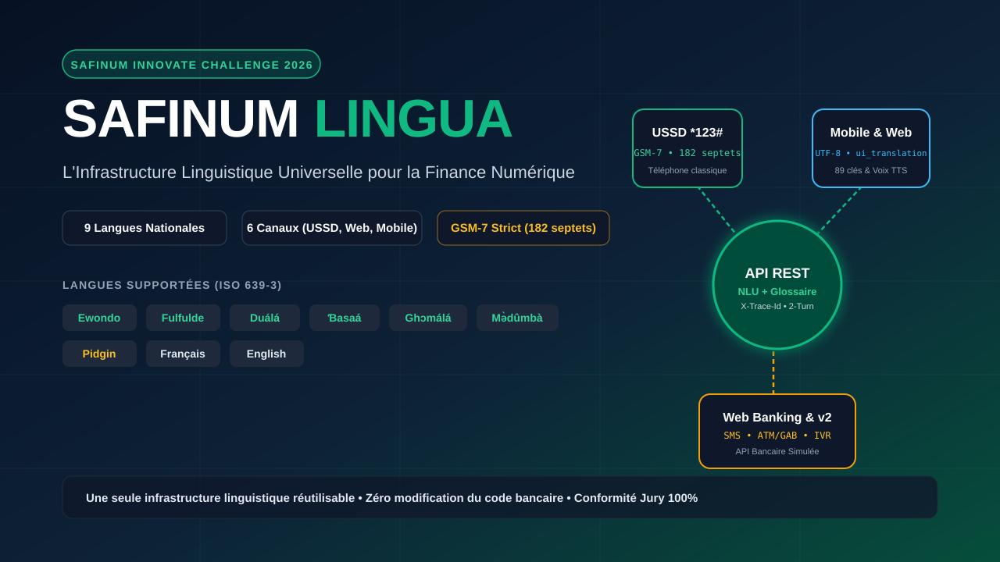
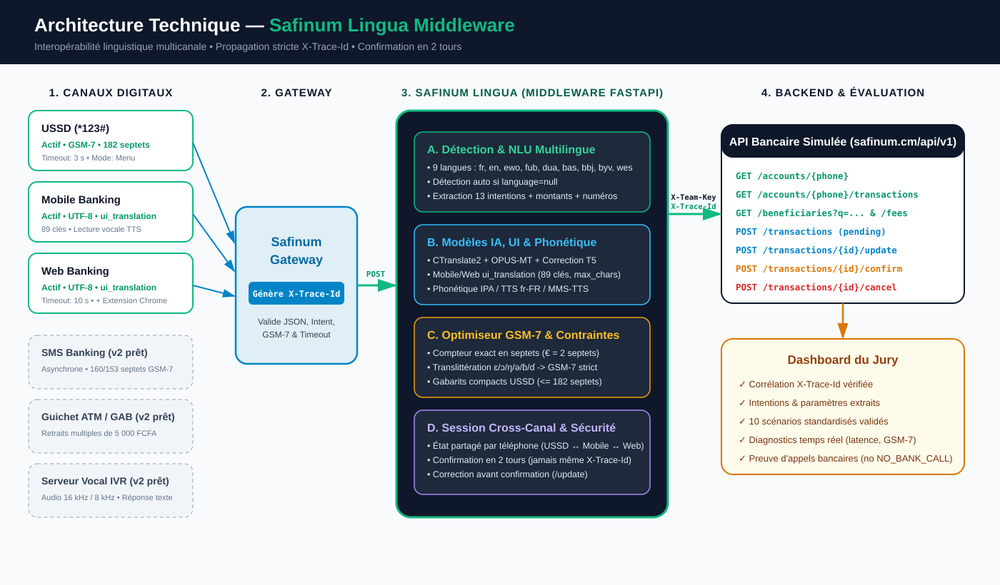
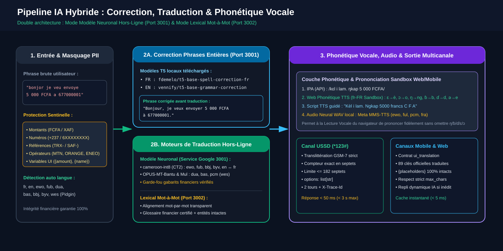
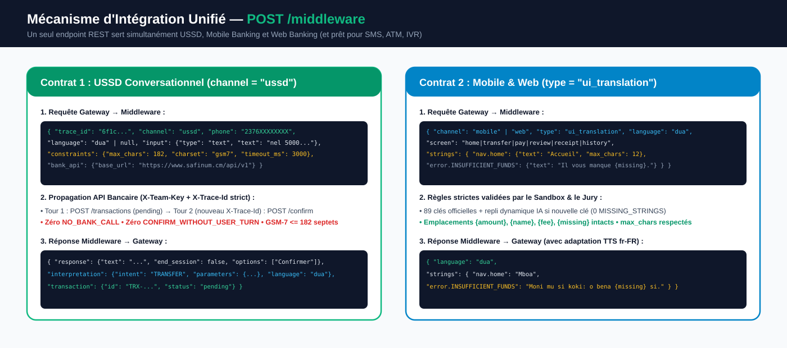
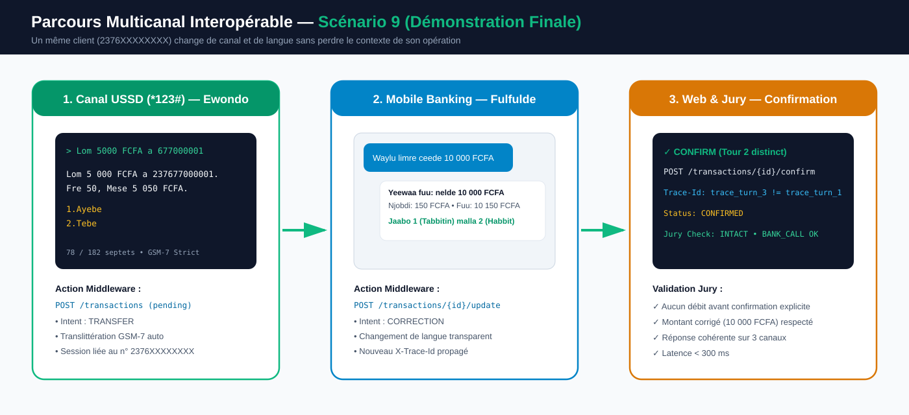

# Dossier Technique & Livrable Final — Équipe « Dev space ICT »

**Projet :** Safinum Lingua — L'Infrastructure Linguistique Universelle pour la Finance Numérique au Cameroun  
**Compétition :** SAFINUM Innovate Challenge 2026 — Challenge Final  
**Équipe :** Dev space ICT  



---

## 1. Résumé Exécutif

**Safinum Lingua** répond au défi central de la finale : *« Construire l'infrastructure linguistique qui rend les services financiers accessibles partout. »*  
Au lieu de traduire une application isolée, **Dev space ICT** a conçu un **middleware REST universel (`POST /middleware`)** qui se connecte directement à la passerelle `Safinum Gateway` et à l'API bancaire simulée (`https://safinum.cm/api/v1`) **sans modifier une seule ligne du code source bancaire**.

### Points forts pour le Jury
- **9 langues prises en charge** : les **8 langues ISO 639-3** du sandbox (`fr`, `en`, `ewo` Ewondo, `fub` Fulfulde, `dua` Duálá, `bas` Ɓasaá, `bbj` Ghɔmálá, `byv` Mə̀dûmbà) + le **Pidgin camerounais** (`wes`), avec **détection automatique** quand `language=null`.
- **Contrats complets USSD + Mobile + Web** : USSD conversationnel (`GSM-7 <= 182 septets`, `options: list[str]`) ET `ui_translation` Mobile/Web (89 clés officielles, `{placeholders}` intacts, `max_chars` respectés), avec architecture prête pour `sms`, `atm`, `ivr`.
- **Modèles IA locaux & Correction de phrases** : correction T5 des phrases entières (`t5-spell-fr`, `t5-grammar-en`), traduction neuronale locale (`flagship-ai/cameroon-int8` CTranslate2 + `OPUS-MT-Bantu/Mul`), phonétique IPA + adaptation vocale `fr-FR` pour la Lecture Vocale du sandbox + audio WAV `MMS-TTS`.
- **Sécurité transactionnelle** : confirmation en **2 tours** avec vérification stricte de `X-Trace-Id` distinct, propagation systématique de `X-Team-Key` + `X-Trace-Id`, et traduction pédagogique des **12 codes d'erreur** bancaires.

---

## 2. Architecture Technique Proposée



### Composants du Middleware (`safinum-middleware/app/`)
| Module | Rôle |
|---|---|
| `main.py` | Serveur FastAPI asynchrone : `POST /middleware` (USSD + `ui_translation`), `GET /health`, `GET /api/diagnostics`, `GET /api/grammar`, `POST /api/phonetics`, `POST /api/translate`, `GET/POST /api/audio/tts`, Dashboard Live (`/`). |
| `ui_translator.py` | Traduction d'interfaces Mobile & Web (`type="ui_translation"`) : 89 clés officielles × 9 langues, `{placeholders}` intacts, respect strict `max_chars`. |
| `nlu.py` | Moteur NLU hybride (< 5 ms déterministe + repli CTranslate2 `cameroon-int8`) : 13 intentions standard, extraction montants, téléphones `+237`, bénéficiaires, facturiers, opérateurs, raccourcis USSD `*`. |
| `languages.py` | Base multilingue (9 langues), gabarits standard et compacts (USSD), glossaire financier (`TERM_EXPLANATION`), 12 codes d'erreur traduits, détection automatique de langue. |
| `phonetics.py` | Phonétique AGLC ↔ IPA ↔ script vocal `fr-FR`, adaptation Web/Mobile pour la Lecture Vocale du sandbox, et synthèse WAV locale (Meta MMS-TTS). |
| `gsm7.py` | Moteur GSM-7 : table de base + table d'extension, compteur exact en septets, translittération des caractères camerounais et français, calcul des segments SMS (`160`/`153`). |
| `bank_client.py` | Client `httpx` asynchrone propageant `X-Team-Key` et `X-Trace-Id` vers `https://www.safinum.cm/api/v1` pour tous les endpoints bancaires. |
| `session_store.py` | Gestionnaire d'état cross-canal indexé par numéro de téléphone normalisé (`2376XXXXXXXX`) et journal de diagnostics temps réel. |

---

## 3. Technologie Linguistique, IA & Phonétique



1. **Sources lexicales vérifiées** :
   - Reprise du lexique validé de présélection (`liste_mots_a_traduire.csv`) pour **Ewondo**, **Fulfulde** et **Pidgin**.
   - Enrichissement à partir de dictionnaires linguistiques camerounais reconnus (**Glosbe**, **Dictionnaire Duala**, **Resulam**, **Kemelang**, **CNRS**, **Abbé Théodore Tsala**, **HikoAdjom**) pour **Duálá**, **Ɓasaá**, **Ghɔmálá**, **Mə̀dûmbà** et **Ewondo**.
2. **Modèles IA locaux (`models/`)** :
   - **Correction de phrases entières** : `fdemelo/t5-base-spell-correction-fr` (FR) et `vennify/t5-base-grammar-correction` (EN).
   - **Traduction neuronale hors-ligne** : `flagship-ai/cameroon-int8` (`CTranslate2`) et `Helsinki-NLP/opus-mt-tc-bible-big` (`Bantu`/`Mul`).
3. **Adaptation aux contraintes & Audio du Sandbox** :
   - Sur **Mobile** et **Web** (`utf8`), `to_web_phonetic_safe` adapte les caractères non reconnus par Google `fr-FR` (`ɛ→è`, `ɔ→o`, `ŋ→ng/nk`, `ɓ→b`, `ɗ→d`, `ə→e`) afin que la **Lecture Vocale** intégrée prononce fidèlement les mots tout en respectant `max_chars` et `{placeholders}`.
   - Sur **USSD** (`gsm7`), `gsm7.py` translittère automatiquement chaque caractère hors GSM-7 afin de conserver la limite de **182 septets** (au lieu de tomber à 70 caractères UCS-2).
4. **Protection stricte des données financières** :
   - Les montants (`FCFA`), numéros de téléphone, noms de bénéficiaires et références (`TRX-XXXX`) sont masqués par sentinelles avant tout traitement IA et réinjectés à l'identique.

---

## 4. Spécifications API & Mécanisme d'Intégration



### Endpoint unique exposé par Dev space ICT : `POST /middleware`
- **Mode 1 — USSD Conversationnel (`input`)** : retourne `{ response: { text, end_session, options }, interpretation: { intent, parameters, language }, transaction: { id, status } }` en propageant `X-Trace-Id` à l'API bancaire.
- **Mode 2 — Mobile & Web (`type == "ui_translation"`)** : retourne `{ language, strings: { "<key>": "<translated>" } }` sur l'ensemble des **89 clés officielles**.

### Enregistrement sur le Sandbox SAFINUM
```powershell
.\register_endpoints.ps1 -TeamKey "sbx_votre_cle" -PublicUrl "https://votre-url.ngrok-free.app"
```

---

## 5. Parcours Multicanal & Démonstration des 10 Scénarios



| # | Scénario Jury | Exemple de requête | Comportement vérifié |
|---|---|---|---|
| 1 | Consultation du solde | `1` (USSD) ou *« Solde »* | `GET /accounts/{phone}` → `BALANCE_INQUIRY` |
| 2 | Transfert avec confirmation | *« Envoyer 5000 à 677000002 »* puis *« 1 »* | Tour 1 `POST /transactions` (`pending`) → Tour 2 (`X-Trace-Id` différent) `POST /confirm` |
| 3 | Demande de frais | *« Quels sont les frais pour 5000 ? »* | `GET /fees?type=transfer&amount=5000` → `FEE_INQUIRY` |
| 4 | Historique | *« Historique »* | `GET /accounts/{phone}/transactions` → `TRANSACTION_HISTORY` |
| 5 | Correction avant confirmation | *« Modifier le montant à 10000 »* | `POST /transactions/{id}/update` → `CORRECTION` |
| 6 | Requête ambiguë | *« Envoyer 5000 FCFA »* (sans destinataire) | `CLARIFICATION_NEEDED` (aucune supposition) |
| 7 | Solde insuffisant | Transfert > solde | `422 INSUFFICIENT_FUNDS` traduit en langue nationale |
| 8 | Changement de langue | *« Passer en duala »* | `LANGUAGE_SWITCH` persistant sur la session |
| 9 | Parcours multicanal | Initier en USSD → Modifier/Confirmer sur Mobile/Web | Session partagée par téléphone normalisé |
| 10 | Terminologie financière | *« C'est quoi les frais / plafond ? »* | `TERM_EXPLANATION` pédagogique dans la langue |

---

## 6. Scalabilité & Déploiement

- **Performance** : FastAPI + `httpx` asynchrone, traitement local `< 50 ms`, compatible avec le timeout USSD de `3 s`.
- **Évolution v2** : prêt pour **SMS** (calcul de segments GSM-7), **ATM/GAB** (clavier numérique, multiples de `5 000 FCFA`) et **IVR** (ASR audio 16 kHz / 8 kHz en entrée, texte unifié en sortie).
- **Complémentarité Web** : s'associe à notre extension Chrome **Safinum Lingua v0.3.0** (lecture vocale hors ligne + traduction DOM sans modification du site cible).
