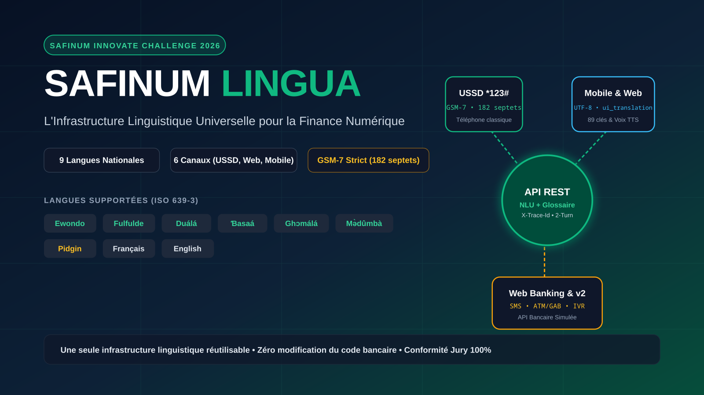
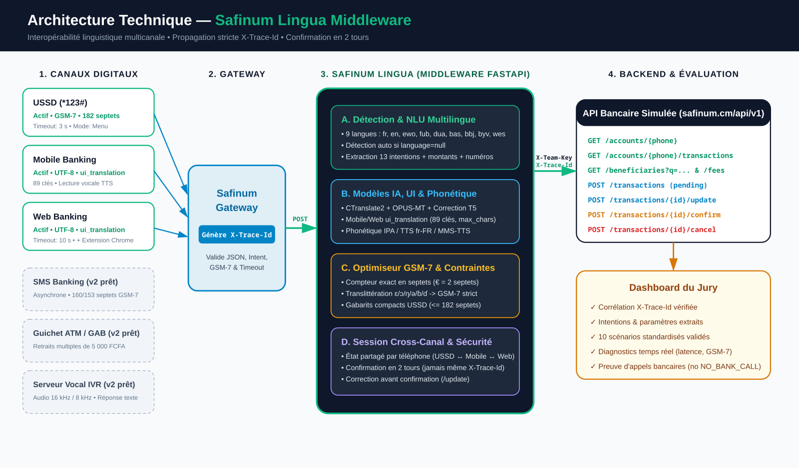
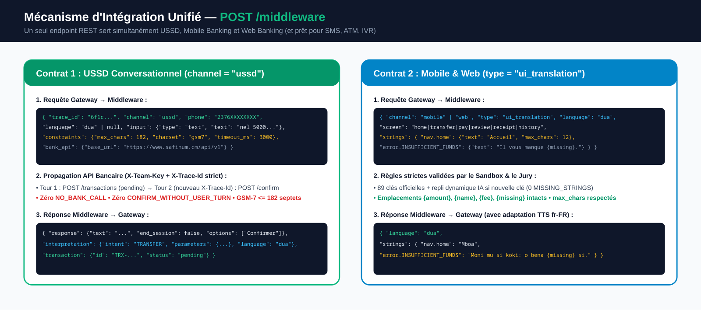
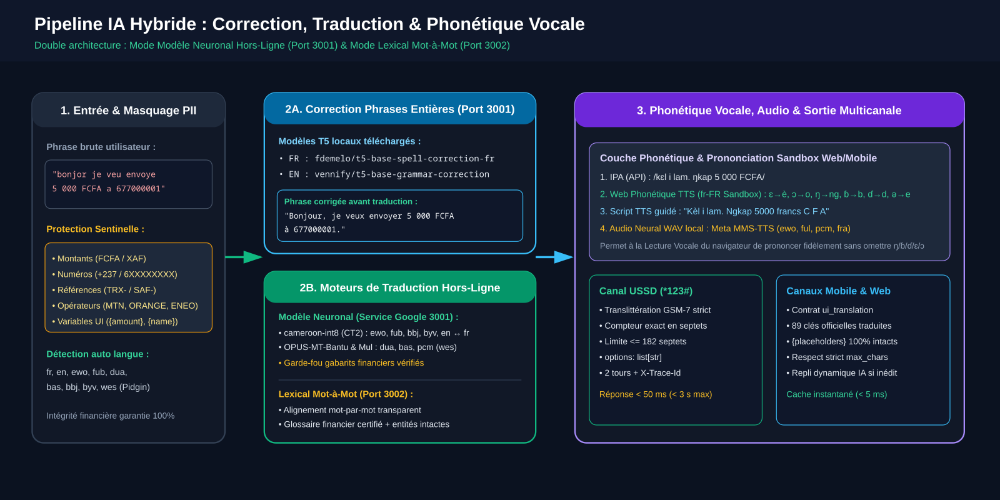
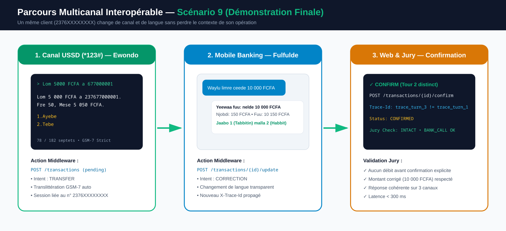

# SAFINUM Lingua — Dossier Technique & Architecture Finale (SAFINUM Innovate Challenge 2026)



## 1. Vision & Proposition de Valeur

> **« Le challenge ne consiste pas simplement à traduire les services financiers. Il s'agit de construire l'infrastructure linguistique qui rend les services financiers accessibles partout. »**

**Safinum Lingua** est une **couche d'infrastructure linguistique universelle et réutilisable** exposée sous forme d'API REST (`POST /middleware`). Elle permet à n'importe quelle institution financière ou canal digital (USSD, Mobile Banking, Web Banking, et prêt pour SMS, ATM/GAB, IVR) d'offrir des services financiers complets dans **9 langues** (Français, Anglais, Ewondo, Fulfulde, Duálá, Ɓasaá, Ghɔmálá, Mə̀dûmbà et Pidgin) **sans modifier le code source bancaire existant**.

---

## 2. Architecture Technique & Contrats Officiels




### Double contrat supporté sur `POST /middleware`
1. **Canal USSD (`*123#`, mode conversationnel)** :
   - Détection de langue (`language=null`), NLU hybride (13 intentions + repli CTranslate2 `cameroon-int8`), appels bancaires avec propagation stricte de `X-Team-Key` + `X-Trace-Id`, confirmation en **2 tours distincts**, `options: list[str]`, translittération et compteur GSM-7 `<= 182 septets` en `< 50 ms` local.
2. **Canaux Mobile & Web (`type == "ui_translation"`)** :
   - Traduction de l'ensemble des **89 clés officielles** sur les 6 écrans (`home`, `transfer`, `pay`, `review`, `receipt`, `history`) en conservant intacts tous les emplacements (`{amount}`, `{name}`, `{fee}`, `{missing}`, `{max}`), en respectant chaque `max_chars`, et avec adaptation phonétique `fr-FR` pour le lecteur vocal intégré du sandbox.

---

## 3. Pipeline IA Hybride, Correction de Phrases & Phonétique



- **Correction de phrases entières (`traduction_service_google/`, Port 3001)** : `fdemelo/t5-base-spell-correction-fr` (FR) et `vennify/t5-base-grammar-correction` (EN) avec masquage sentinelle des montants, numéros et références.
- **Traduction neuronale hors-ligne (`models/`)** : `flagship-ai/cameroon-int8` (CTranslate2 int8 pour `ewo`, `fub`, `bbj`, `byv`, `en` ↔ `fr`) + `Helsinki-NLP/opus-mt-tc-bible-big` (`dua`, `bas`, `wes`/`pcm`).
- **Traduction lexicale transparente (`traduction_mot_a_mot/`, Port 3002)** : alignement mot-par-mot vérifié + protection des entités + GSM-7.
- **Phonétique & Audio (`phonetics.py`)** : IPA, adaptation vocale `fr-FR`, script TTS guidé et audio WAV neural local (`Meta MMS-TTS`).

---

## 4. Parcours Multicanal Interopérable (Scénario 9)



---

## 5. Couverture des 10 Scénarios Standardisés du Jury

| # | Scénario | Intention / Mode | Appel API Bancaire (`X-Trace-Id` propagé) | Comportement Safinum Lingua |
|---|---|---|---|---|
| 1 | Consultation du solde | `BALANCE_INQUIRY` | `GET /accounts/{phone}` | Retourne le solde exact dans la langue cible (compact GSM-7 en USSD). |
| 2 | Transfert avec confirmation | `TRANSFER` → `CONFIRM` | `POST /transactions` puis `POST /transactions/{id}/confirm` | Tour 1 initie (`pending`) ; Tour 2 (`X-Trace-Id` différent) confirme. |
| 3 | Demande de frais | `FEE_INQUIRY` | `GET /fees?type=&amount=` | Explique les frais exacts et le total à débiter. |
| 4 | Historique des opérations | `TRANSACTION_HISTORY` | `GET /accounts/{phone}/transactions` | Résume les dernières opérations (3 en USSD, 5 en Mobile/Web). |
| 5 | Correction avant confirmation | `CORRECTION` | `POST /transactions/{id}/update` | Met à jour montant/bénéficiaire sur la transaction `pending` et redemande confirmation. |
| 6 | Demande ambiguë | `CLARIFICATION_NEEDED` | `GET /beneficiaries?q=` (si nom) | Ne devine jamais ; demande le montant, le bénéficiaire ou l'homonyme exact. |
| 7 | Solde insuffisant | `TRANSFER` (échec) | `POST /transactions` → `422 INSUFFICIENT_FUNDS` | Traduit l'erreur clairement dans la langue nationale sans exposer le code brut. |
| 8 | Changement de langue | `LANGUAGE_SWITCH` | — | Bascule immédiatement et persiste la langue sur la session du client. |
| 9 | Parcours multicanal | `TRANSFER` / `CORRECTION` / `ui_translation` | `POST /transactions*` | Session partagée par téléphone entre `ussd`, `mobile` et `web`. |
| 10 | Terminologie financière | `TERM_EXPLANATION` / `help.*` | — | Explique *frais, solde, plafond, bénéficiaire, référence* de façon pédagogique. |

---

## 6. Guide de Déploiement Rapide

```bash
cp .env.example .env
../.venv/bin/uvicorn app.main:app --host 0.0.0.0 --port 3000
ngrok http 3000
```
Déclarer l'URL publique sur `https://www.safinum.cm/api/v1/sandbox/endpoint` pour `ussd`, `mobile` et `web`.
